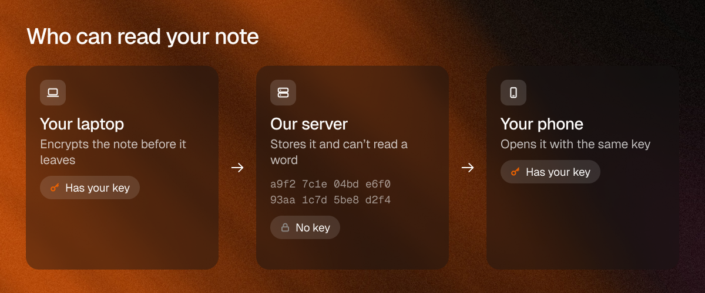

You probably keep things in your notes app that you wouldn't post anywhere: plans, money, health, passwords you swore you'd move somewhere safer. So the question is fair. If something goes wrong at the company behind the app, who can read them?

In 2026 the answer came from places most people don't think about. Notes and AI chats leaked through a company's AI vendor, through a share link that Google picked up, through a plugin, and through a fake streaming app on a phone. We went through six of these cases and asked the same thing each time: would this have reached notes in Fixnote? Here's what we found, including the one case where our answer is "no app can fully protect you."

## 1. Your AI chats were sitting at a vendor (Notion, November)

**What happened.** Notion ran some of its AI features through a company called Fireworks AI. Fireworks was breached, and transcripts of chats from one Notion AI feature were exposed for fewer than 1% of workspaces. Notion found its own access keys inside the leaked messages and revoked them. Notion itself wasn't hacked. The data leaked at the vendor ([BleepingComputer](https://www.bleepingcomputer.com/news/security/notion-says-fireworks-breach-exposed-customer-ai-chat-transcripts/), [The Hacker News](https://thehackernews.com/2026/11/fireworks-ai-breach-widens-to-expose.html)).

**What it means for you.** When an app stores your AI conversations in readable form, you're trusting every company it works with, not just the app. One breach anywhere in that chain is enough.

**In Fixnote.** Your chats with the assistant stay on your device. They aren't on our server at all. When you ask a question, your device searches your notes first, and the model only gets the few passages that answer it. It never gets your whole collection or your chat history.

You also pick where the AI runs:

- With **Fixnote AI**, those passages go through our server to the model provider, and we don't log what's in them.
- With **your own API key**, your device talks to your provider directly.
- With **Ollama** on your computer, or the model built into the app (in beta), nothing leaves the machine and it works offline.

With Fixnote AI, the passages for your question do pass through the provider, so a breach there could touch them. For notes you never want to leave your computer, use a local model.

## 2. Share links ended up in Google (Claude and DeepSeek, July)

**What happened.** People found that searching Google for Claude's share links turned up other people's conversations, some with resumes and health details. The pages weren't marked "don't index." Shared DeepSeek chats were showing up the same way. Anthropic fixed it, though many old links stayed reachable for a while ([TechRepublic](https://www.techrepublic.com/article/news-claude-shared-chats-google-search/), [Cybernews](https://cybernews.com/ai-news/deepseek-data-leak-shared-chats-google-index/)).

**What it means for you.** A share link feels private because only the people you send it to know it. If the page is public and a search engine finds it, anyone can read it.

**In Fixnote.** The key that opens a [shared note](/features/share-links/) sits in the part of the link after the `#`. Browsers never send that part to a server, so the copy we store is encrypted and we can't read it. Search engines ignore that part too. Even if a link were indexed, the page would show scrambled text without the key. And the Fixnote web app asks search engines not to index it in the first place.

## 3. A meeting bot that recorded everyone (Otter.ai, August)

**What happened.** A court in California let the main privacy claims against Otter.ai go forward. The people suing say its bot joined meetings on its own, recorded everyone on the call, built voiceprints of participants and used the conversations to improve its AI. None of this has been proven, and the case is ongoing. Fireflies.ai faces similar lawsuits ([Bloomberg Law](https://news.bloomberglaw.com/litigation/otter-ai-stuck-with-privacy-lawsuit-over-meeting-transcriptions)).

**What it means for you.** If your meeting notes come from a bot that joins the call, everything said goes to a third party, including what other people said.

**In Fixnote.** [Call summaries](/features/call-summaries/) work without a bot. The desktop app listens to your microphone and your computer's sound, and turns speech into text on your computer while the call goes on. No recording is kept, there are no voiceprints, and nothing is used to train AI. Only the text goes to the model that writes the summary. Telling the people on the call that you're taking notes is still on you.

## 4. A plugin that installed a trojan (Obsidian, April)

**What happened.** Attackers shared an Obsidian vault set up with a community plugin that can run commands on your computer. People who had plugin sync turned on and opened the vault got a remote-access trojan on Windows or macOS. The targets worked in finance and crypto ([The Hacker News](https://thehackernews.com/2026/04/obsidian-plugin-abuse-delivers.html)).

**What it means for you.** Plugins make an app flexible, and each one is code from someone you've probably never checked.

**In Fixnote.** There are no third-party plugins, and nothing inside a note can run code. We chose that on purpose: you can extend Fixnote less, and this kind of attack has nowhere to start.

## 5. Connecting AI apps to your notes (MCP, all year)

**What happened.** MCP is the standard way apps like Claude and ChatGPT connect to your other tools, notes included. In the first two months of 2026 alone, researchers filed more than 30 security bugs against MCP servers and tools. One was in the official toolkit itself: under some setups, one user could get answers meant for another. Researchers also found thousands of MCP servers open on the internet with no sign-in at all ([MCP's first year](https://medium.com/ai-security-hub/mcps-first-year-what-30-cves-and-500-server-scans-tell-us-about-ai-s-fastest-growing-attack-6d183fc9497f), [Vulnerable MCP Project](https://vulnerablemcp.info/)).

**What it means for you.** Connecting an AI app to your notes means a new door into them. How that door is built matters.

**In Fixnote.** When you [connect Fixnote to Claude or ChatGPT](/features/mcp/), our relay holds neither your notes nor your keys. It passes each request to one of your own devices, which opens the notes, answers and sends back only the result. Each account has its own separate space on the relay, so answers can't cross between people. You choose which folders the AI app can see and whether it can write. It can never delete anything.

## 6. Malware that reads note apps (Perseus, March)

**What happened.** Security researchers at ThreatFabric found Perseus, Android malware disguised as TV-streaming apps. Once installed, it reads apps like Google Keep, Samsung Notes, Evernote and OneNote, looking for passwords and crypto recovery phrases. It's the first known malware built to go after note apps ([ThreatFabric](https://www.threatfabric.com/blogs/perseus-dto-malware-that-takes-notes)).

**What it means for you.** This one is about your phone, not the notes company.

**Where our protection ends.** Encryption keeps your notes safe on our server and on the way there. If malware on your device can see your screen, it sees what you see, and no notes app can stop that. We do make the most sensitive thing harder to grab: Fixnote shows your [recovery phrase](/blog/recovery-phrase/) only after a code sent to your email. The researchers' advice holds for every app, ours included: keep passwords and recovery phrases in a password manager, not in notes.

## What to check before you trust a notes app with private things

Whatever app you end up using, these five questions tell you a lot:

1. **Can the company read your notes?** Look for end-to-end encryption that's on by default, where only your devices hold the key.
2. **Where do your AI chats live,** and does the AI see all your notes or only what it needs for one question?
3. **What happens to a share link** if someone finds it or a search engine picks it up?
4. **Can plugins or add-ons run code** on your computer?
5. **What can a connected AI app do:** read everything, or only the folders you allow? Can it delete?

## How Fixnote answers those questions

When you create an account, your device makes a key and shows it to you once as 12 words. It stays on your devices, in your system's password store on a computer. Every note is [encrypted on your device](/features/encryption/) with its own key before it's sent, and so are images, files and folder names.

Our server sees your email, when notes changed and encrypted data it can't open. It doesn't see what you wrote, what your folders are called, your pictures or what you search for. Shared notes are encrypted separately for each person you share with. Messages you save from Telegram, Discord or the browser extension are locked with your key the moment they arrive, so only your app can open them. The details are in [How end-to-end encryption works in Fixnote](/blog/end-to-end-encrypted-notes/).

## What we can't promise

- Your device is the boundary. Notes on it are stored so the app can work offline and search instantly, so turn on BitLocker on Windows or FileVault on a Mac.
- If you lose the 12 words and every device, nobody can bring your notes back, us included.
- A cloud AI model sees the passages you ask it about.
- We can see that a note changed at 14:03. We can't see what changed.

If you'd rather nothing reached a server at all, the Free plan keeps your notes on your device only, and [local-only mode](/features/offline/) turns off sync, sharing and capture, with AI running only on your computer.

Every incident above started with someone holding data they could read. The safest note is one the company keeping it has no way to open.
