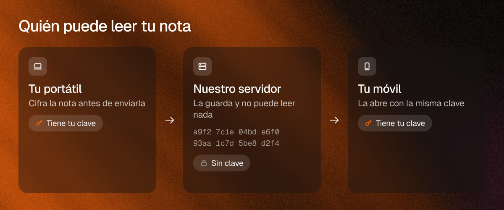

Seguramente guardas en tu app de notas cosas que no publicarías en ningún sitio: planes, dinero, salud, contraseñas que te prometiste mover a un lugar más seguro. Así que la pregunta es justa: si algo sale mal en la empresa que hay detrás de la app, ¿quién puede leerlas?

En 2026 la respuesta llegó desde sitios en los que casi nadie piensa. Notas y chats de IA se filtraron a través del proveedor de IA de una empresa, de un enlace compartido que Google indexó, de un plugin y de una app falsa de streaming en un móvil. Repasamos seis de estos casos y en cada uno nos hicimos la misma pregunta: ¿habría llegado esto a las notas en Fixnote? Esto es lo que encontramos, incluido el caso en el que nuestra respuesta es «ninguna app puede protegerte del todo».

## 1. Tus chats de IA estaban en un proveedor (Notion, noviembre)

**Qué pasó.** Notion usaba una empresa llamada Fireworks AI para algunas de sus funciones de IA. Fireworks sufrió una brecha, y quedaron expuestas transcripciones de chats de una función de Notion AI en menos del 1 % de los espacios de trabajo. Notion encontró sus propias claves de acceso dentro de los mensajes filtrados y las revocó. A Notion no lo hackearon: los datos se filtraron en el proveedor ([BleepingComputer](https://www.bleepingcomputer.com/news/security/notion-says-fireworks-breach-exposed-customer-ai-chat-transcripts/), [The Hacker News](https://thehackernews.com/2026/11/fireworks-ai-breach-widens-to-expose.html)).

**Qué significa para ti.** Cuando una app guarda tus conversaciones con la IA en un formato legible, confías en todas las empresas con las que trabaja, no solo en la app. Basta una brecha en cualquier punto de esa cadena.

**En Fixnote.** Tus chats con el asistente se quedan en tu dispositivo. No están en nuestro servidor. Cuando haces una pregunta, tu dispositivo busca primero en tus notas, y el modelo solo recibe los pocos fragmentos que la responden. Nunca recibe todas tus notas ni tu historial de chat.

Además, eliges dónde funciona la IA:

- Con **Fixnote AI**, esos fragmentos pasan por nuestro servidor hasta el proveedor del modelo, y no registramos su contenido.
- Con **tu propia clave de API**, tu dispositivo habla directamente con tu proveedor.
- Con **Ollama** en tu ordenador, o con el modelo integrado en la app (en beta), nada sale del equipo y funciona sin conexión.

Con Fixnote AI, los fragmentos de tu pregunta sí pasan por el proveedor, así que una brecha allí podría afectarles. Para las notas que no quieres que salgan nunca de tu ordenador, usa un modelo local.

## 2. Enlaces compartidos en Google (Claude y DeepSeek, julio)

**Qué pasó.** Alguien descubrió que al buscar en Google los enlaces compartidos de Claude aparecían conversaciones de otras personas, algunas con currículos y datos de salud. Las páginas no estaban marcadas para no indexarse. Los chats compartidos de DeepSeek aparecían igual. Anthropic lo corrigió, aunque muchos enlaces antiguos siguieron accesibles un tiempo ([TechRepublic](https://www.techrepublic.com/article/news-claude-shared-chats-google-search/), [Cybernews](https://cybernews.com/ai-news/deepseek-data-leak-shared-chats-google-index/)).

**Qué significa para ti.** Un enlace compartido parece privado porque solo lo conocen las personas a las que se lo envías. Si la página es pública y un buscador la encuentra, cualquiera puede leerla.

**En Fixnote.** La clave que abre una [nota compartida](/es/features/share-links/) va en la parte del enlace que sigue a `#`. Los navegadores nunca envían esa parte a un servidor, así que la copia que guardamos está cifrada y no podemos leerla. Los buscadores también ignoran esa parte: aunque un enlace se indexara, la página mostraría texto cifrado sin la clave. Y la app web de Fixnote pide a los buscadores que no la indexen.

## 3. Un bot de reuniones que grababa a todos (Otter.ai, agosto)

**Qué pasó.** Un tribunal de California dejó seguir adelante las principales demandas de privacidad contra Otter.ai. Quienes demandan afirman que su bot entraba solo en las reuniones, grababa a todos los participantes, creaba huellas de voz y usaba las conversaciones para mejorar su IA. Nada de esto está probado y el caso sigue abierto. Fireflies.ai tiene demandas parecidas ([Bloomberg Law](https://news.bloomberglaw.com/litigation/otter-ai-stuck-with-privacy-lawsuit-over-meeting-transcriptions)).

**Qué significa para ti.** Si tus notas de reuniones salen de un bot que entra en la llamada, todo lo que se dice llega a un tercero, también lo que dicen los demás.

**En Fixnote.** Los [resúmenes de llamadas](/es/features/call-summaries/) funcionan sin bot. La app de escritorio escucha tu micrófono y el sonido de tu ordenador, y convierte la voz en texto en tu ordenador mientras dura la llamada. No se guarda ninguna grabación, no hay huellas de voz y nada se usa para entrenar IA. Solo el texto llega al modelo que escribe el resumen. Avisar a las personas de la llamada de que tomas notas sigue siendo cosa tuya.

## 4. Un plugin que instalaba un troyano (Obsidian, abril)

**Qué pasó.** Unos atacantes compartieron una bóveda de Obsidian preparada con un plugin de la comunidad que puede ejecutar comandos en tu ordenador. Quienes tenían activada la sincronización de plugins y abrían la bóveda recibían un troyano de acceso remoto en Windows o macOS. Los objetivos trabajaban en finanzas y criptomonedas ([The Hacker News](https://thehackernews.com/2026/04/obsidian-plugin-abuse-delivers.html)).

**Qué significa para ti.** Los plugins hacen flexible una app, y cada uno es código de alguien a quien probablemente nunca has revisado.

**En Fixnote.** No hay plugins de terceros, y nada dentro de una nota puede ejecutar código. Lo elegimos a propósito: puedes ampliar Fixnote menos, y este tipo de ataque no tiene por dónde empezar.

## 5. Conectar apps de IA a tus notas (MCP, todo el año)

**Qué pasó.** MCP es la forma estándar en que apps como Claude y ChatGPT se conectan a tus otras herramientas, también a tus notas. Solo en los dos primeros meses de 2026, los investigadores registraron más de 30 fallos de seguridad en servidores y herramientas MCP. Uno estaba en el propio kit oficial: con algunas configuraciones, un usuario podía recibir respuestas destinadas a otro. También encontraron miles de servidores MCP abiertos en internet sin ningún inicio de sesión ([el primer año de MCP](https://medium.com/ai-security-hub/mcps-first-year-what-30-cves-and-500-server-scans-tell-us-about-ai-s-fastest-growing-attack-6d183fc9497f), [Vulnerable MCP Project](https://vulnerablemcp.info/)).

**Qué significa para ti.** Conectar una app de IA a tus notas abre una puerta nueva hacia ellas. Importa cómo está construida esa puerta.

**En Fixnote.** Cuando [conectas Fixnote a Claude o ChatGPT](/es/features/mcp/), nuestro relé no guarda ni tus notas ni tus claves. Pasa cada petición a uno de tus dispositivos, que abre las notas, responde y devuelve solo el resultado. Cada cuenta tiene su propio espacio aislado en el relé, así que las respuestas no se cruzan entre personas. Tú eliges qué carpetas puede ver la app de IA y si puede escribir. Nunca puede borrar nada.

## 6. Malware que lee apps de notas (Perseus, marzo)

**Qué pasó.** Los investigadores de seguridad de ThreatFabric encontraron Perseus, un malware para Android disfrazado de apps de streaming de televisión. Una vez instalado, lee apps como Google Keep, Samsung Notes, Evernote y OneNote en busca de contraseñas y frases de recuperación de criptomonedas. Es el primer malware conocido creado para ir a por apps de notas ([ThreatFabric](https://www.threatfabric.com/blogs/perseus-dto-malware-that-takes-notes)).

**Qué significa para ti.** Este caso va de tu móvil, no de la empresa de notas.

**Dónde acaba nuestra protección.** El cifrado protege tus notas en nuestro servidor y por el camino. Si un malware en tu dispositivo puede ver tu pantalla, ve lo mismo que tú, y ninguna app de notas puede impedirlo. Lo que sí hacemos es poner más difícil lo más sensible: Fixnote solo muestra tu [frase de recuperación](/es/blog/frase-de-recuperacion/) después de un código enviado a tu correo. El consejo de los investigadores vale para cualquier app, también la nuestra: guarda contraseñas y frases de recuperación en un gestor de contraseñas, no en notas.

## Qué revisar antes de confiar cosas privadas a una app de notas

Uses la app que uses, estas cinco preguntas dicen mucho:

1. **¿Puede la empresa leer tus notas?** Busca cifrado de extremo a extremo activado por defecto, con la clave solo en tus dispositivos.
2. **¿Dónde se guardan tus chats con la IA,** y la IA ve todas tus notas o solo lo que necesita para una pregunta?
3. **¿Qué pasa con un enlace compartido** si alguien lo encuentra o un buscador lo indexa?
4. **¿Pueden los plugins o complementos ejecutar código** en tu ordenador?
5. **¿Qué puede hacer una app de IA conectada:** leerlo todo, o solo las carpetas que permitas? ¿Puede borrar?

## Cómo responde Fixnote a esas preguntas

Cuando creas una cuenta, tu dispositivo genera una clave y te la muestra una vez como 12 palabras. Se queda en tus dispositivos, en el almacén de contraseñas del sistema en un ordenador. Cada nota se [cifra en tu dispositivo](/es/features/encryption/) con su propia clave antes de enviarse, y también las imágenes, los archivos y los nombres de las carpetas.

Nuestro servidor ve tu correo, cuándo cambiaron las notas y datos cifrados que no puede abrir. No ve lo que escribiste, cómo se llaman tus carpetas, tus imágenes ni lo que buscas. Las notas compartidas se cifran por separado para cada persona con la que las compartes. Lo que guardas desde Telegram, Discord o la extensión del navegador se cierra con tu clave en cuanto llega, así que solo tu app puede abrirlo. Los detalles están en [Cómo funciona el cifrado de extremo a extremo en Fixnote](/es/blog/notas-cifrado-de-extremo-a-extremo/).

## Lo que no podemos prometer

- Tu dispositivo es el límite. Las notas se guardan en él para que la app funcione sin conexión y busque al instante, así que activa BitLocker en Windows o FileVault en un Mac.
- Si pierdes las 12 palabras y todos tus dispositivos, nadie puede recuperar tus notas, nosotros tampoco.
- Un modelo de IA en la nube ve los fragmentos sobre los que le preguntas.
- Podemos ver que una nota cambió a las 14:03. No podemos ver qué cambió.

Si prefieres que nada llegue a un servidor, el plan gratuito guarda tus notas solo en tu dispositivo, y el [modo local](/es/features/offline/) desactiva la sincronización, el uso compartido y la captura, con la IA funcionando solo en tu ordenador.

Todos los casos de arriba empezaron con alguien que guardaba datos que podía leer. La nota más segura es la que la empresa que la guarda no tiene forma de abrir.
